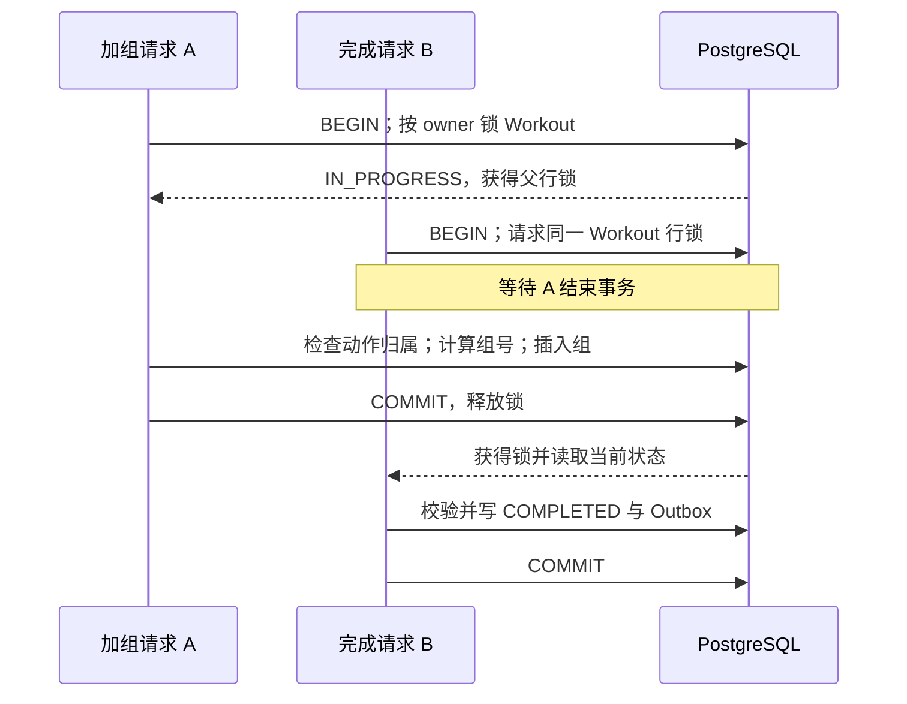
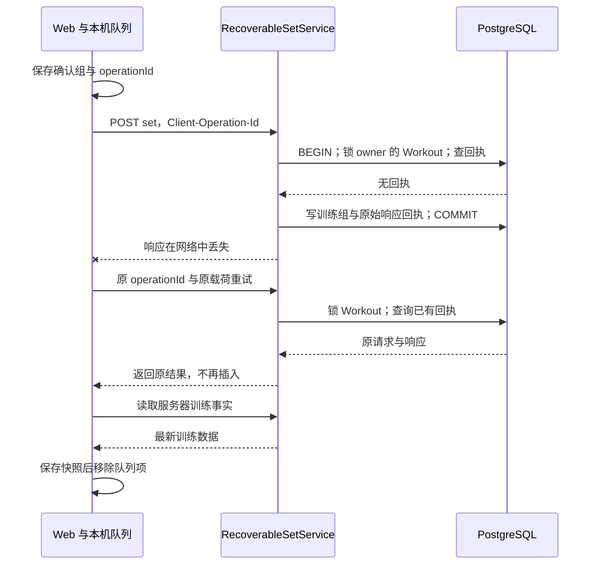

# 亮点 1–2：训练一致性与离线恢复

[返回总览](README.md)。源码基线与证据范围见总览；本页时序图是实现机制说明，不是新增实验。

## 亮点 1：领域快照与统一训练写协议

### 问题与业务不变量

计划表达未来意图，会被修改；Workout 表达实际发生的训练。如果历史页面一直关联当前计划，用户修改目标组数或动作后，过去的记录就可能变样。因此开始训练时复制动作名称、目标组次、RPE、休息时间等快照，实际组记录另行保存。

并发问题不仅是两个请求取到相同组号。假设加组请求先看到 `IN_PROGRESS`，随后另一请求完成训练，前者继续插入，就产生“已完成后新增训练组”的非法状态。唯一组号约束无法阻止这种状态穿越。

需要守住三件事：历史事实不随计划漂移；新写入必须针对进行中的训练；同一动作下组号不能冲突。

### 方案为什么成立

`WorkoutService` 的动作新增、组新增/修改/删除以及完成/取消遵守同一个入口协议：事务内根据当前用户锁定父级 Workout，持锁后检查状态，再操作子记录。锁持续到事务结束。

锁住父行后，即便两个请求操作不同动作，也在同一训练范围内串行。这牺牲同一训练内部并发度，但使“完成”和所有写操作共享一个互斥边界。数据库唯一约束继续兜底，不替代状态检查。

如果 B 先获得锁并完成，A 随后读取到完成状态，应拒绝新的组写入。关键是检查与修改都处于同一锁协议内，不是只在 Controller 预查状态。

### 优化、验证和局限

历史实现拿到父行锁后，取组号还对动作子行执行一次 `FOR UPDATE`。在所有相关入口遵守父锁协议的前提下，子锁没有增加正确性，却增加 SQL 往返。优化移除这次重复锁定，仍保留父锁与唯一约束。

[写链路报告](../performance/workout-write-load-2026-09-17.md)记录：固定 32 并发、16 数据库连接，同一训练共 192 次写入，吞吐从 282.64 到 332.25 RPS，P99 从 228.67 到 170.38 ms；错误为 0。这里是 **192 次操作，不是 192 个并发线程**。多用户场景未改善，不能说整个系统性能提升 17.56%。

此实验是 Service + Testcontainers，不包含 HTTP、鉴权及生产网络成本，也不是多轮统计置信结论。

后续若新增入口绕过父锁，优化前提就被破坏；同训练串行也仍有锁等待。需要用并发测试守住协议，性能扩展先测不同用户负载，而不是直接去掉锁。

### 故障案例与追问

**机制案例：完成与加组竞态。** 错误方案是查状态后无锁插入；正确方案将两者放进共同的事务锁边界。验证应断言最终状态、组数和唯一约束，而不只看 HTTP 200。

- **为什么不用 synchronized？** 只保护一个 JVM；数据库行锁覆盖共享数据库的多个应用实例。
- **为什么不只用唯一索引？** 索引阻止重复编号，不知道训练是否已结束。
- **为什么不用全库 Serializable？** 当前不变量可以用明确的聚合锁解决；扩大隔离范围会增加冲突与重试成本。
- **如何防死锁？** 统一先父后子的访问顺序、缩短事务；不能声称因此永远不会死锁。
- **快照是不是冗余？** 是有业务语义的冗余，用存储换历史稳定；不是每次查询复制最新计划。

源码：[WorkoutService](../../src/main/java/com/fitpilot/workout/application/WorkoutService.java)。验证入口：[WorkoutConcurrencyIT](../../src/test/java/com/fitpilot/workout/application/WorkoutConcurrencyIT.java)、[并发协议报告](../release/workout-write-concurrency.md)。

**口述版：**“我把计划和训练事实分开，并把一场训练看作写入一致性边界。所有写入先锁父级训练，锁内检查状态，再改子记录。确认协议完整后，去掉重复子行锁，固定条件下同训练写入 P99 降低了 25.47%；不同用户场景没有改善，所以只声明局部收益。”

## 亮点 2：离线补交与持久化幂等回执

### 问题与方案

用户在健身房可能断网、刷新或切后台。尤其危险的是服务器已经保存，响应却丢失：客户端不能判断成功与否，重新生成一次请求会重复记组。

方案把“填写草稿”和“用户已确认的组”分开。草稿随输入保存；确认组先保存到按账户隔离的本机队列，每条操作生成稳定 UUID，再尝试上传。重试继续使用同一 UUID，而不是每次发送生成新 ID。

后端 `RecoverableSetService` 在一个事务内锁 Workout 并查询回执。命中相同操作与载荷时返回原响应；同 ID 换动作或载荷返回 409；未命中时新增组并保存回执，二者一起提交。查回执在新组状态检查之前，使成功操作在训练结束后仍能重放结果，而不重新插入。

### 设计取舍

| 选择 | 原因 | 代价或边界 |
|---|---|---|
| 数据库回执而非仅 Redis TTL 去重 | 组与回执能原子提交，长时间离线不依赖缓存寿命 | 增加持久化数据与维护成本 |
| 每个确认组独立存储键 | 减少不同标签页覆盖整条队列的风险 | 需要枚举、校验和处理损坏记录 |
| 本机先落盘再显示保存成功 | 避免存储失败却向用户承诺成功 | localStorage 配额或回收仍可能导致失败 |
| 冲突保留队列并允许导出 | 不替用户决定覆盖已结束训练或丢弃记录 | 部分冲突需要人工处理 |

Web Locks 只减少标签页重复发送；即使不支持，最终仍靠后端幂等。Service Worker 缓存静态资源，不缓存私有 API 响应或令牌；这和登录凭据管理是不同问题。

### 验证与故障案例

[自动恢复报告](../release/workout-auto-recovery.md)与[设备场景补验](../release/workout-recovery-device-validation-2026-09-19.md)覆盖响应丢失、断网刷新、账户隔离、存储失败、原操作重放与双设备冲突。固定写实验中 96 个操作各额外重放两次，共 288 次请求，最终 96 行、96 回执、1 个完成事件。

**受控故障：设备 B 已完成训练，A 还留有未上传组。** A 上传新操作收到冲突，保留本地内容并提示；刷新后展示服务器已结束状态。不能为了“同步成功”自动重新打开训练，也不能静默删除本机数据。

### 局限与追问

- 清除站点数据、换设备、浏览器回收存储会丢失尚未同步内容；本机保存不是云端备份。
- 当前支持离线记录已开始的训练，不包括离线新建、最终完成训练或任意冲突合并。
- 移动端证据是浏览器仿真，未证明物理手机后台回收和系统杀进程场景。
- **相同 ID 不同内容为何拒绝？** 否则调用方能把一次操作偷偷改成另一条，回执语义被破坏。
- **为什么已有组删除后还返回旧回执？** 回执证明原操作完成过，不代表这条组现在仍存在；页面再读取当前事实。

源码：[RecoverableSetService](../../src/main/java/com/fitpilot/workout/application/RecoverableSetService.java)、[队列同步](../../web/src/features/workout/syncWorkoutQueue.ts)、[本机存储](../../web/src/features/workout/workoutRecoveryStore.ts)。

**口述版：**“我解决的是不确定提交，不只是断网缓存。客户端先持久化操作 UUID，后端把业务写入和回执放在同一个事务里。响应丢失后重复提交返回原结果；真正的状态冲突则保留队列交给用户处理。”
