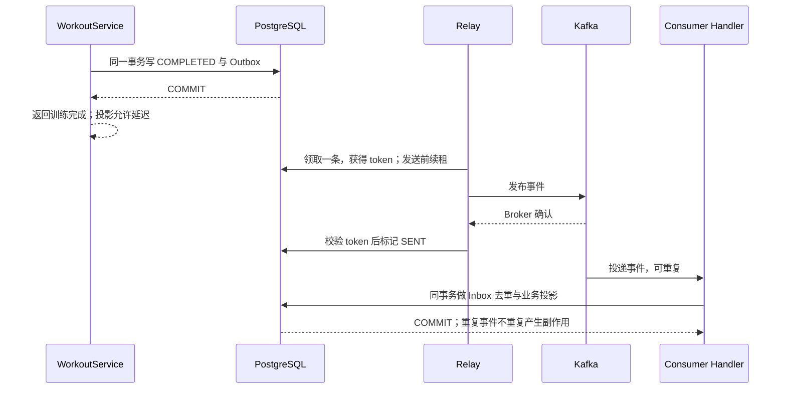
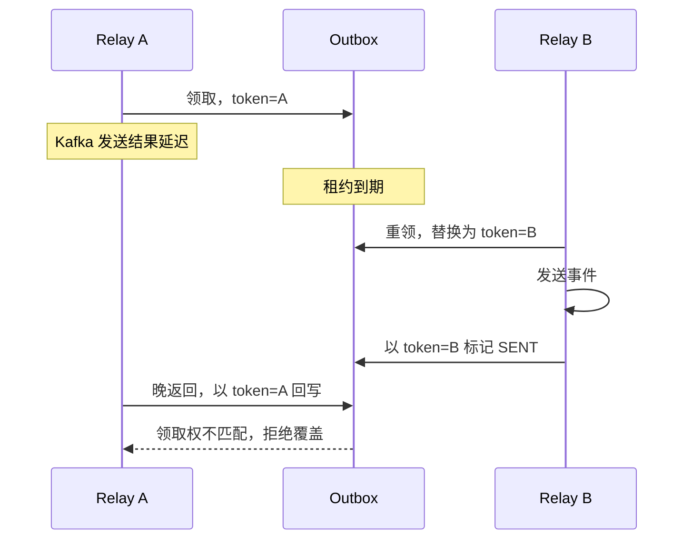
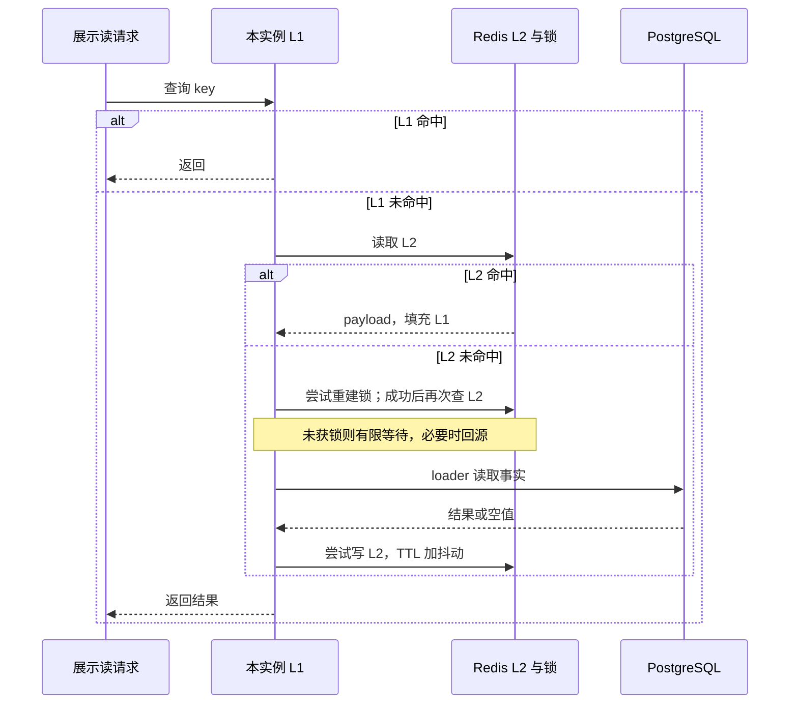

# 亮点 3–4：可靠事件与缓存取舍

[返回总览](README.md)。本页将原子提交、投递、消费与展示新鲜度分别解释，避免把不同层面的保证混为一谈。

## 亮点 3：Outbox、Inbox 与领取权保护

### 问题与方案

数据库事务不能自动覆盖 Kafka：先更新训练再发消息，进程可能在两步之间退出；先发消息再提交数据库，又可能让消费者处理最终回滚的训练。把 Kafka 调用塞进普通数据库事务并不能使两个系统原子提交，还会延长持锁时间。

完成训练时只把 `Workout=COMPLETED` 和 Outbox 记录写入同一 PostgreSQL 事务。提交后由 Relay 投递。Kafka 故障时训练事实已完成，派生统计等恢复后追平。

投递侧必须接受重复：Broker 已保存消息，但 Relay 没收到确认或没写回 SENT，重试就会再次发送。消费侧使用数据库 Inbox 记录处理身份，在事务内和业务投影一起提交，再用业务唯一约束兜底。这个组合实现的是至少一次投递下的幂等副作用，不是端到端 Exactly Once。

### 为什么还需要 token

租约超时只是“允许别人接管”，不会停止旧线程。旧 A 可能在新 B 领取之后才从 Kafka 返回。如果仅按事件 ID 更新状态，旧 A 就会覆盖 B 的进度。领取 token 随接管更换，续租、成功及失败回写均校验当前领取权。

token 保护 Outbox 状态，不能撤回已经发送的消息，也不能取代消费者 Inbox。

### 真实修复案例与验证

历史 Relay 一次领取 100 条后逐条等待发送。前部事件阻塞时，尾部租约在尚未发送前就可能到期。当前实现是**每次发送前领取一条**，batch size 仅限制每轮处理数量，消除尾部预领等待的来源；仍保持顺序等待，不宣称已实现有界并发发送。

[积压恢复报告](../performance/outbox-backlog-recovery-2026-09-17.md)记录真实 Broker 下两个 Relay 对象的受控重领：Kafka 收到两次，旧 token 回写被拒，业务投影各一份。另一场景由 40 次训练形成约 200 条事件，恢复追平 3.80 秒；这是一次测试，120 秒积压年龄通过回拨时间合成，不能叫生产恢复 SLO。

[双实例演练](../performance/real-model-event-cache-validation-2026-09-19.md)另验证两个独立 Spring Boot 容器中 A 领取后停止、B 接管追平。它与同进程双 Relay 实验是不同证据，不能把两者规模与恢复时间拼接。

### 设计取舍、局限与追问

| 备选方案 | 好处 | 当前选择的理由与限制 |
|---|---|---|
| 同步更新全部派生数据 | 逻辑简单，返回时统计立即可见 | 增加完成事务耗时与耦合；小规模完全可以考虑 |
| PostgreSQL 任务表消费 | 组件更少，也可实现可靠重试 | 消费分发、回放等要自己治理；不能说一定比 Kafka 差 |
| Outbox + Kafka | 可分离派生消费者、隔离 Broker 故障 | 增加 Broker、积压、死信和监控成本，当前未证明生产规模必要性 |

- **投递成功但回写失败？** 会重投；Inbox 和业务唯一约束使副作用不重复。
- **Inbox 先提交，业务失败怎么办？** 必须在同一数据库事务里；否则会产生错误的“已处理”。
- **SENT 是否代表统计已完成？** 只代表发送侧确认，消费投影应单独观察。
- **Kafka 故障能保证 5 秒内结束吗？** 不能。历史冷启动实验暴露 metadata/观测等待，Future 超时不覆盖整个调用路径。
- **能保证跨事件严格顺序吗？** 本材料不作此承诺；扩展并发须单独审查聚合顺序和消费者语义。
- **何时加并行 Relay？** 积压年龄和恢复速率证明串行成为瓶颈后，再设计有界并发、背压与顺序约束。

源码：[OutboxRelay](../../src/main/java/com/fitpilot/infrastructure/events/OutboxRelay.java)、[OutboxRepository](../../src/main/java/com/fitpilot/infrastructure/events/OutboxRepository.java)、[WorkoutCompletedEventHandler](../../src/main/java/com/fitpilot/infrastructure/events/WorkoutCompletedEventHandler.java)。测试：[OutboxLeaseIT](../../src/test/java/com/fitpilot/infrastructure/events/OutboxLeaseIT.java)。

**口述版：**“数据库与消息队列双写不能靠一个本地事务解决，所以先原子保存训练与 Outbox，再至少一次投递。消费端用事务内 Inbox 和唯一约束去重。我还处理了租约接管后旧执行者晚回写的问题，并把批量预领改为发送前逐条领取。”

## 亮点 4：热点缓存、短 TTL 与故障降级

### 问题与读写流程

高复用展示读反复访问数据库有成本，但缓存不是业务事实来源。展示可以接受短暂旧值；训练开始等关键判断必须读取数据库，避免使用旧 ACTIVE 计划做决定。

读取依次检查 Caffeine L1、Redis L2；L2 未命中时尝试获取分布式重建锁，拿到后再次检查缓存，再回源和填充。没拿到锁的请求有限等待，之后可回源，避免无限阻塞。因此不是“任何情况下只允许一次 DB 查询”。空值也缓存，TTL 加抖动减少集中失效。

写入先提交数据库，再删除本实例 L1 与共享 L2。若提交前删除，并发读可能在数据库提交前把旧值重新填入。提交后删除降低这个窗口，但仍不能消除所有并发回填竞态。

### 多实例与降级的真实边界

实例 A 删除本机 L1，无法自动删除 B 的 L1；当前接受展示最终收敛，L1 默认 5 秒、L2 默认 30 秒加最多 5 秒抖动。不能由此承诺全局陈旧时间严格小于 5 秒：失效失败、并发回填以及多层 TTL 都影响实际窗口。

Redis 故障时缓存操作捕获错误并回源，限流可降为进程内 Token Bucket。它提升局部可用性，也把压力转移给数据库，而且各实例本地限流之和不再等于全局配额；不是无代价的“故障无感”。

### 验证与设计取舍

[缓存对照](../performance/real-model-event-cache-validation-2026-09-19.md)为热/冷各 3 轮、每轮 600 次：热点 L1 命中明显减少调用成本，但冷读两级缓存 P95 约 2.8–3.2 ms，PG 直读约 0.5–0.6 ms。另一缓存对象约 5.05 秒观察到更新，是局部一次观测，不是全局上限。

这意味着缓存适合重复热点，不能用来宣称所有请求都加速。当前报告是局部组件实验，不是多实例 HTTP 容量验证；Redis 故障峰值下 DB 是否扛得住，还需专项容量证据。

- **为什么不用 Redis 就够了？** L1 省一次网络与序列化访问；代价是跨实例新鲜度和进程内存。
- **为什么不做广播失效？** 短 TTL 在当前展示需求下更简单；广播还要处理漏消息、重连和补偿，不能自动变成强一致。
- **什么场景不用缓存？** 低复用冷数据、强新鲜度决策，或数据库直读已经满足目标且缓存无收益的路径。
- **分布式锁为何不能直接 DEL？** 超时后可能已被别人获取，应以持有者令牌执行 compare-and-delete，避免删除新持有者的锁。

源码：[TwoLevelCache](../../src/main/java/com/fitpilot/infrastructure/performance/TwoLevelCache.java)。边界报告：[短 TTL 策略](../release/short-ttl-cache-consistency.md)。

**口述版：**“两级缓存主要服务高复用展示读，关键判断直接查数据库。实验中热点收益明显，但冷读反而增加开销，所以我保留了适用范围和负结果。Redis 故障可以回源，但要考虑数据库压力和限流退化。”
