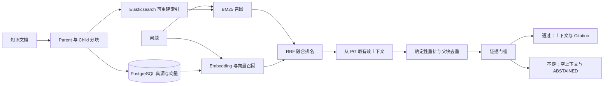
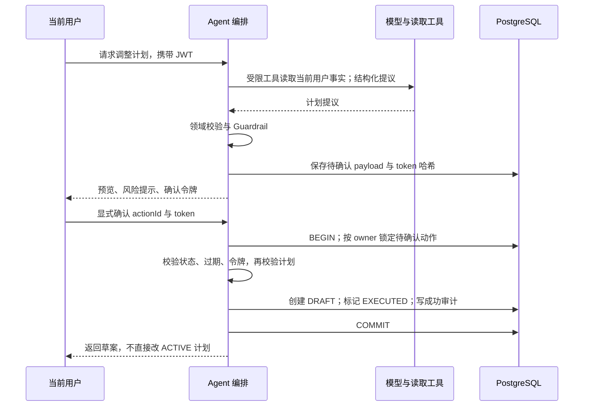

# 亮点 5–6：RAG 与受控 Agent

[返回总览](README.md)。AI 亮点要同时回答效果与控制：检索有没有找到证据，模型有没有正确使用，业务写入是否仍由服务端约束。

## 亮点 5：混合检索、引用治理与无答案控制

### 问题与方案

健身问答同时包含专业术语和自然语言改写。BM25 擅长词项匹配，但同义表达可能召回不足；向量模型能够表达部分语义关系，也可能把“话题相近”误当作“包含答案”。两路检索的原始分数不在同一尺度，不能简单相加。

项目把文档切成用于检索的 Child Chunk 与用于补充上下文的 Parent Chunk。分别用 Elasticsearch BM25、pgvector 向量搜索召回，以 RRF 合并排名，再按确定性规则重排、按父块去重，经过证据门槛后返回上下文和引用。

RRF 可概括为 `score(d) = Σ weight_i / (k + rank_i(d))`，使用名次而非原始分值降低尺度不一致问题。它不保证一定优于单路，也不等同于训练出的 Cross-Encoder reranker。

这张图是逻辑分支，不宣称当前源码并发执行双路检索。当前 `HybridRetrievalService` 先调用 lexical 再调用 vector。PG 保存文档与生命周期事实，ES 是可重建检索索引；单路故障允许降级，双路均不可用则返回服务不可用，不伪装成“没有答案”。

### 为什么必须有拒答与引用治理

搜索通常会返回最相近的候选，即使语料中根本没有答案。比赛规则、具体剂量或品牌比较等问题，不能因为找到同主题训练文档就附上引用。Citation 只能说明来源，不能自动证明这段来源支持答案。

`EvidenceSupportGate` 对查询做归一化与词元处理，检查锚点覆盖及某些具体事实要求。候选不过门槛时不暴露为引用，返回 `ABSTAINED` 与原因。这是保守规则，不是通用语义蕴含判定器。

知识治理同时维护来源、版本和生命周期，过滤撤销或失效文档，并处理 ES 删除传播。用户反馈要经审核才进入动态评测集，避免错误反馈直接污染质量基准。

### 实验结果应怎么讲

| 实验 | 观测 | 能证明什么 | 不能证明什么 |
|---|---|---|---|
| 真实 MiniLM Embedding、10 篇合成文档、28 问 | 场景题 Hybrid MRR 为 1.0；改写题增益未达预设门槛，术语题有回退 | 三路质量与延迟存在取舍 | Hybrid 普遍更优、真实用户效果 |
| 后续证据门槛、LOCAL 确定性向量、20 道独立难负例 | 0/20 返回潜在引用；50 道回归题三路 Recall@3 均 50/50 | 该规则在固定语料与样本下有效 | 真实语义模型下相同效果、最终生成答案无幻觉 |

来源：[真实 Embedding 对照](../performance/real-embedding-retrieval-2026-09-17.md)、[独立无答案验收](../performance/rag-abstention-2026-09-19.md)。两组实验模型与样本不同，不能说“真实模型误引率从 100% 降为 0%”。

**失败案例：相似不等于有据。** 早期真实检索实验中三条路径均对 4 道无答案题返回候选，说明单靠 Top-K 不足以判断可答。后续增加证据门槛，另冻结新样本验收；保留失败实验，不用揭盲后的题反复调到满分再宣称泛化。

### 设计取舍与追问

- **为什么不是只用 BM25？** 当前小语料 BM25 已很有竞争力，保留它作基线；混合方案是待验证的增益选择，不能用架构复杂度代替效果证据。
- **为何 Child 检索、Parent 回填？** 小块便于精确命中，父块补足语境；代价是上下文更长、可能带入噪声和增加 Token。
- **Recall 与 MRR 区别？** Recall@K 关注相关来源能否进入前 K；MRR 关注第一个正确来源的排序。单相关来源小语料易出现 Recall 饱和，因此要分题型分析。
- **证据门槛会不会误拒？** 会。词面覆盖可能拒绝有效改写，因此要同时测无答案误引与可回答召回，不能只优化拒答率。
- **为什么不只让 LLM 自检？** 自检也会出错并增加成本；仍需独立标注、留出集与服务端约束。

源码：[HybridRetrievalService](../../src/main/java/com/fitpilot/rag/application/HybridRetrievalService.java)、[EvidenceSupportGate](../../src/main/java/com/fitpilot/rag/application/EvidenceSupportGate.java)。测试：[RagAbstentionAcceptanceIT](../../src/test/java/com/fitpilot/evaluation/RagAbstentionAcceptanceIT.java)。

**口述版：**“我实现了双路召回，但没有预设 Hybrid 一定最好。小样本实验显示场景题有收益、术语题会退化；更关键的是无答案问题仍会返回相似候选，所以增加了独立证据门槛，并区分检索拒答与最终答案正确性。”

## 亮点 6：模型提议、服务端授权、用户确认

### 问题与职责分工

模型可能编造工具名、生成非法训练参数，甚至从输入中接受其他用户的 ID。仅在 Prompt 中写“不要越权”不是权限控制。项目把模型限制为结构化决策与文本生成组件，工具执行仍由后端掌握。

身份来自 JWT，工具入参不能自行指定 userId；读取工具继承当前用户并做 owner 限制。工具名单和写入工作流受限，计划经过领域规则及 Guardrail。涉及疼痛或数据不足的调整会阻断，不把生成文字当作可执行计划。

提议生成待确认记录，原始确认令牌返回客户端，服务端只存 SHA-256。用户确认时，按 userId 与 actionId 锁定记录，检查待确认状态、有效期与令牌，重新校验计划。创建草案、标记执行和记录成功调用处于同一事务中。

一次性来自数据库状态与锁，哈希用于减少持久化令牌泄漏风险；只计算哈希并不能防重放。两个确认同时到达时，后一个获得锁后看到已处理状态而被拒绝。若本次数据库事务失败，草案与已执行标记一起回滚。

### 模型调用失败怎么办

主备端点和重试由调用层统一治理，使用 deadline、Semaphore 并发隔离与熔断；配置中的主备/重试共享预算，不能理解为整个多步骤 Agent 请求都必然在 20 秒内结束。单个工作流可能包含多次模型调用。

模型关闭、调用失败或输出解析/校验失败时，`LlmGateway` 可返回规则 Workflow。降级仍走同一写入验证与确认流程。必须记录模型与降级状态，不能把“最终接口返回成功”算成真实模型成功。

### 验证、取舍与局限

[FitPilotLlmFlowIT](../../src/test/java/com/fitpilot/FitPilotLlmFlowIT.java)和[FitPilotApiIT](../../src/test/java/com/fitpilot/FitPilotApiIT.java)等提供 Mock Provider、API 与安全流程的回归证据；[真实模型验收记录](../performance/real-model-event-cache-validation-2026-09-19.md)仍将外部真实模型质量标为未执行。当前可以讲工程约束，不能宣称真实 LLM 的任务成功率、成本优势或训练效果提升。

| 选择 | 收益 | 代价 |
|---|---|---|
| 固定单 Agent 工作流 | 工具顺序和写入路径可审查 | 自由规划能力受限 |
| 显式确认，仅新建草案 | 用户能查看后果，避免直接修改当前计划 | 多一步交互，转化率可能受影响 |
| 规则降级 | 模型不可用时保留部分流程 | 输出能力和个性化程度下降 |
| 数据库会话为真源 | 跨设备恢复不依赖 Redis 存活 | 需要保留周期和隐私治理 |

- **为何不用 Multi-Agent？** 当前任务有固定工具与清晰状态，尚无拆分角色带来可测收益的证据。
- **确认前事实变了怎么办？** 确认不是永久授权；必须按确认路径重新校验。当前锁定待确认记录不等于冻结所有读取事实，不能宣称消除所有快照过期风险。
- **Prompt Injection 完全解决了吗？** 没有。服务端缩小可执行权限，但文本误导、敏感内容与模型质量仍需专项评估。
- **给外部系统写入也能直接复用这个事务吗？** 不能；当前草案是本库写入。外部副作用需额外设计幂等、Outbox 或补偿。

源码：[LlmGateway](../../src/main/java/com/fitpilot/llm/application/LlmGateway.java)、[PendingActionService](../../src/main/java/com/fitpilot/agent/application/PendingActionService.java)、[ConfirmationService](../../src/main/java/com/fitpilot/agent/application/ConfirmationService.java)。

**口述版：**“Agent 可以提出计划，不能获得写库权限。我把身份、工具白名单、规则校验和一次性确认放在后端。确认过程锁定待执行动作，在同一事务内创建草案并标记完成；模型故障回退规则时也不绕过这些限制。”
