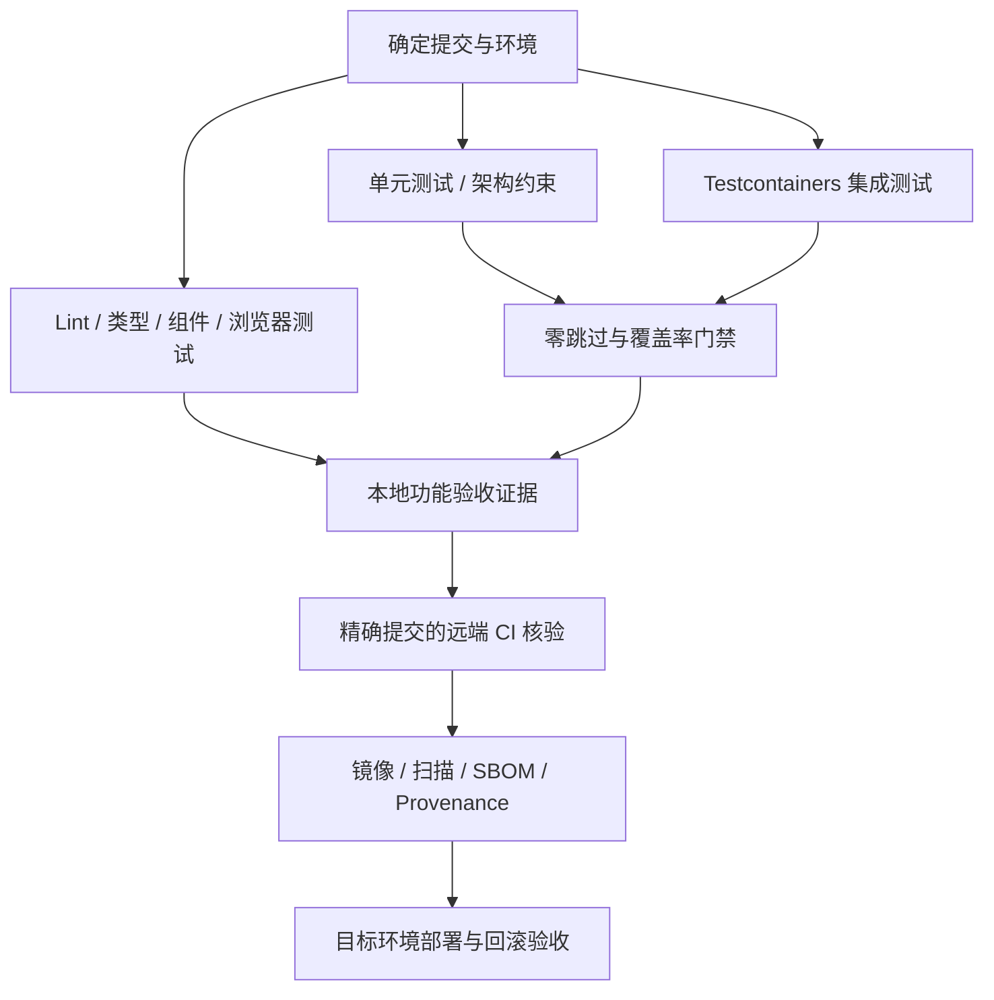

# 亮点 7：工程质量、证据与故障答辩

[返回总览](README.md)。本材料的目标是让“实现了”与“验证到什么范围”一一对应。

## 问题、方案与验证层次

多中间件、异步和 AI 链路最容易出现“接口返回成功，但副作用错误”或“Mock 测试通过，但真实依赖不兼容”。只报覆盖率也不能说明业务不变量正确。

项目用分层验证回答不同问题：单元测试检查规则与分支，Testcontainers 检查真实数据库和中间件行为，Playwright 检查用户路径，ArchUnit 检查模块边界，实验报告比较性能与故障语义。CI 把后端与前端门禁拆开，失败更容易定位。

这张图表达逐层增加的证明责任，不表示本轮所有层均已执行。镜像构建成功不等于部署成功，部署成功也不等于真实用户效果达标。

### 已归档结果

[V20 功能验收](../release/v20-functional-validation.md)绑定 `9bd259c`：后端 74 单元 + 48 集成 = 122，失败/错误/跳过均为 0；行覆盖率 85.75%。前端 44 个测试、8 个常规与 3 个离线浏览器场景通过，行覆盖率 76.26%。

本轮基线为 `f2117c6`，没有重跑以上门禁，不能把旧报告改个日期当成当前结果。配置有覆盖率门禁，不等于本轮执行过门禁。

### 可观测性怎么服务排障

| 现象 | 优先看什么 | 区分哪些问题 |
|---|---|---|
| 完成训练后统计未更新 | Outbox 状态/积压年龄、Kafka 消费、Inbox/投影 | 未发送、已发未消费、消费失败 |
| 写入尾延迟变高 | 锁等待、连接池等待、SQL 与调用时延 | 同训练争用、连接不足、外部调用 |
| AI 成功响应但质量差 | 实际模型、降级标记、工具调用、Prompt 版本 | 规则兜底、模型失败、检索缺证据 |
| Redis 故障后数据库繁忙 | 缓存命中、回源量、数据库负载、错误率 | 缓存降级把压力转移到 DB |

日志、指标和链路追踪用于建立假设；定位之后仍需复现和修复前后验证，不能只凭一张 Grafana 截图认定根因。LLM 审计需要脱敏，评测报告不能泄漏令牌。

## 可以直接讲的故障案例

| 案例与性质 | 问题及关键证据 | 处理 | 验证与剩余边界 |
|---|---|---|---|
| 重复子行锁：实测优化 | 同训练写入尾延迟高，父锁后再次锁子行 | 保留统一父锁，移除额外 SQL 往返 | 固定实验 P99 降 25.47%；多用户未改善，不是 HTTP 容量 |
| 离线响应丢失：受控测试 | 服务端已提交，客户端仍认为失败 | 同 operationId 重放数据库回执 | 不重复入库；不保证本机存储永不丢失 |
| Outbox 预领尾部过期：机制与实验 | 前部发送等待消耗尾部租约，旧执行者还可能晚回写 | 逐条领取 + token 条件回写 + Inbox | 受控重复投递无重复副作用；冷启动 metadata 等待仍有边界 |
| 无答案检索返回候选：已记录失败实验 | 相近段落并不包含题目事实 | 增加证据门槛，冻结新难负例 | LOCAL 验收 0/20 潜在引用；不是生成模型零幻觉 |
| 跨设备 E2E 超时：CI 失败定位 | 慢 runner 下后台刷新移除输入框，fill 等待超时 | 显式控制设备 A 尚未观察到关闭的测试状态 | Windows 与 Linux 目标场景各连续 10 次通过；不代表生产事故修复 |

故障来源依次见[写链路报告](../performance/workout-write-load-2026-09-17.md)、[离线补验](../release/workout-recovery-device-validation-2026-09-19.md)、[积压报告](../performance/outbox-backlog-recovery-2026-09-17.md)、[拒答报告](../performance/rag-abstention-2026-09-19.md)、[V20 远端跟进](../release/v20-functional-validation.md)。

### 故障回答模板：以 E2E 为例

> 现象是本地通过但远端 Web 门禁失败。开始只能拿到退出码，不能确定根因，所以没有直接归因于 runner 慢或网络问题。我先把后端与 Web 门禁拆开，再从失败步骤定位到跨设备离线场景：设备 A 后台刷新使输入框消失，测试仍在等待填写。修复明确控制测试所需的未观察状态，同时保留 409、记录保留和刷新后结束状态的断言。目标场景在 Windows 和 Linux 各重复 10 次通过。这个案例证明测试时序被修正，不证明业务出现过同样的生产事故。

## 设计取舍与常见追问

- **为什么不用全 Mock？** Mock 适合验证规则分支，不能覆盖 PostgreSQL 锁、Flyway、Kafka 或 Redis 实际语义；真实依赖测试成本较高，因此按层分工。
- **覆盖率 85.75% 是否说明可靠？** 只说明历史运行触达的代码比例；并发、幂等和错误状态仍需专门断言。
- **为什么阻止跳过测试？** 避免 Docker 不可用导致集成测试未执行却产生“全绿”。门禁要检查报告，而不只依赖命令退出码。
- **为什么不每次都跑全部压测？** 压测需要固定环境、数据与负载，适合验证性能假设；日常 CI 优先稳定功能回归，不能把波动很大的容量阈值随意加入每次提交。
- **测试和生产的差别？** 真实流量分布、数据规模、硬件、网络、运行时间和运维条件不同。Mock LLM 与规则模式还缺真实模型质量维度。
- **已有可观测栈为什么还需实验？** 观测显示现象，对照实验验证改变是否有效；两者不能互相替代。

**口述版：**“我把验证拆成规则、真实依赖、用户操作和发布证据几层。对并发和异步流程，检查最终业务不变量而非只看状态码；测试报告绑定提交与环境，远端构建和生产部署另行核验。”

## 数字与证据台账

| 可引用数字 | 必须同时说明 | 证据 |
|---|---|---|
| 同训练写 P99 降 25.47% | 本地 Service；32 并发；192 次操作；单轮固定条件对照 | [写链路实验](../performance/workout-write-load-2026-09-17.md) |
| 96 个操作重放后仍 96 行 | 每个额外重放两次；288 次请求；检查回执与事件 | 同上 |
| 两实例故障后业务重复 0 | 一条真实训练、受控停实例、本地 Docker | [真实模型/事件/缓存报告](../performance/real-model-event-cache-validation-2026-09-19.md) |
| 无答案候选 0/20 | 合成语料、LOCAL 向量、规则门槛；非最终回答质量 | [拒答验收](../performance/rag-abstention-2026-09-19.md) |
| 后端 122 测试、85.75% 行覆盖 | `9bd259c` 历史 V20 本地验收 | [V20 报告](../release/v20-functional-validation.md) |
| 600 迭代、820 HTTP、P95 15.05 ms | 2026-11-01 账号池修复低负载验证；10 迭代/秒，1 分钟，HTTP 含初始化 | [压测 README](../../load-test/README.md) |

最后一项只验证压测脚本修复，不是高负载容量；迭代速率不等于 HTTP QPS。不要将 V5 历史 30 分钟报告和当前脚本低负载运行拼成新验收。引用旧报告时保留版本与模型模式。

## 5 分钟演示脚本

这是建议的演示顺序，本轮没有实际执行。

1. **0:00–0:40，交代业务。** 用准备好的演示账户展示计划与最近训练，说明核心事实和派生统计的差异。
2. **0:40–1:40，展示记录。** 开始训练，记录一组，说明快照与实际组记录；不要临时修改数据库来伪造指标。
3. **1:40–2:40，离线恢复。** 断网记录一组，展示本机待同步；联网后核对服务器只多一组。提前确保静态资源已缓存。
4. **2:40–3:30，事件闭环。** 完成训练后展示 PR/统计及事件状态，说明投影允许短暂延迟。故障注入使用单独录屏或隔离环境。
5. **3:30–4:30，AI 确认。** 使用有足够历史的演示账户生成提议，查看依据，确认生成 DRAFT；显示真实模型或规则模式，不隐藏降级。
6. **4:30–5:00，说明证据。** 打开一份原始实验与对应结论，主动说明未覆盖的生产、真机或真实模型范围。

## 自查：每个亮点是否真的会讲

- 不看文档，能在两分钟内画出核心数据流，并说出事实最终存在哪里。
- 能指出一个失败时序及拦截它的具体事务、锁、约束或状态检查。
- 能找到对应源文件和测试，解释为什么测试能验证该不变量。
- 能给出一种更简单的替代方案，并说明当前复杂度带来的成本。
- 能区分“已实现”“历史验证”“本轮未验证”和“未来计划”。

待补证据按岗位选择：当前提交完整门禁与远端状态核验、固定规格 HTTP 多用户容量、真实模型留出集质量与成本、物理移动设备恢复。无需全部完成才介绍项目，但未完成项不能写成简历成果。
