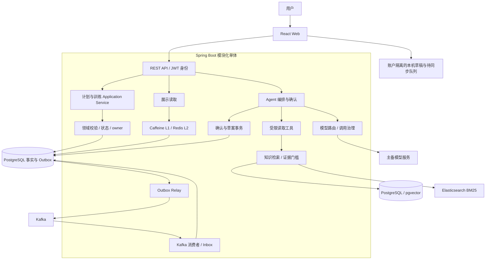

# FitPilot 面试材料导航

整理日期：2026-11-01。源码核对基线：`f2117c6`。本轮只整理文档并静态核对实现，没有重跑业务测试、压测、真实模型或远端发布。下文数字均指向各自历史报告，不能合并成当前版本或生产环境的验收结论。

## 怎样使用

先用下面的总览介绍项目，再选择三项亮点展开。每项按“业务问题 → 关键不变量 → 实现机制 → 验证 → 代价与局限”回答，控制在 2–3 分钟；追问时打开时序图和源码。故障案例标明了实测、受控演练或机制推演，不要讲成真实线上事故。

| 材料 | 内容 | 适合回答 |
|---|---|---|
| [训练与离线恢复](14-训练一致性与离线恢复.md) | 亮点 1、2；并发写、快照、持久化回执、响应丢失时序 | 数据一致性、事务、锁、幂等、产品体验 |
| [事件与缓存](15-可靠事件与缓存取舍.md) | 亮点 3、4；Outbox/Inbox、领取权、最终一致性、缓存降级 | Kafka、Redis、故障恢复、性能取舍 |
| [RAG 与 Agent](16-RAG与受控Agent.md) | 亮点 5、6；检索、拒答、确认写入、模型降级 | AI 应用工程、评测、安全边界 |
| [质量与故障答辩](17-质量证据与故障案例.md) | 亮点 7；质量门禁、故障卡、证据台账、演示脚本 | 工程能力、排障、实验可信度 |

Java 后端方向优先讲训练一致性、离线幂等、可靠事件；AI 方向优先讲受控 Agent、RAG 评测，再补事务一致性。无需一次介绍所有组件。

## 90 秒项目介绍

> FitPilot 是一个训练记录和 AI 辅助计划调整项目。用户可以制定计划、记录每组训练、查看个人纪录和趋势，再根据训练事实申请调整建议。
>
> 我把系统分成核心训练事实、异步派生数据和 AI 辅助决策三部分。训练事实保存在 PostgreSQL：计划与历史快照分离，训练写入通过事务和统一父行锁保证状态一致，离线补交使用数据库回执实现幂等。完成训练后，通过 Outbox 和 Kafka 更新个人纪录、分析与通知，接受派生数据短暂延迟。
>
> AI 侧只让模型提出结构化建议，由后端校验身份、领域规则和风险，用户确认后创建草案。检索与模型都有失败和降级路径。我重点验证了并发写入、响应丢失重放和事件接管，并保留检索实验中的负结果。当前证据主要来自本地测试与受控实验，不把它们包装成生产规模。

以上是表达模板；“我设计、我实现、我定位”应以本人真实参与程度为准。使用辅助工具完成的部分，应能独立解释和修改。

## 总体架构图

PG 与 pgvector 为同一 PostgreSQL 技术栈的不同职责视图，不表示强制拆分数据库。Prometheus、Tracing 和审计横跨链路，未在图中逐个画出。图表示职责与数据路径，不表示这些模块分别部署。

## 架构为什么这样划分

| 决策 | 解决的问题 | 支付的代价 | 何时重新评估 |
|---|---|---|---|
| 模块化单体 | 保持本地事务和较低部署复杂度；用 ArchUnit 约束依赖 | 共同发布、进程资源共享 | 出现独立扩缩容、团队或隔离需求 |
| PostgreSQL 作为业务事实来源 | 事务、约束与恢复有统一依据 | 数据库容量成为重要约束 | 实测瓶颈出现后按访问模式治理 |
| 训练同步提交，统计异步更新 | 避免派生计算和 Kafka 故障阻断完成训练 | 最终一致、重试与运维复杂度 | 产品要求完成响应立即含准确统计 |
| 展示读允许短暂旧值 | 降低热点读开销 | 多实例缓存不强一致 | 新鲜度要求超过短 TTL 能力 |
| 模型提议、服务端执行 | 限制幻觉参数和越权写入 | 交互步骤增加、能力更受约束 | 扩展工具时逐项评估，不直接放开写权限 |

跨模块通过 Application Service 或事件协作；领域层不依赖基础设施。具体约束以 [ArchUnit 测试](../../src/test/java/com/fitpilot/architecture/ModuleBoundaryArchitectureTest.java) 为准，不把“分包”本身当作架构质量证明。

## 面试前必须统一的口径

- 当前训练写协议锁住的是父级 `workout` 行；不要再说主要依赖 `workout_exercise` 子行锁取号。
- 当前 Relay 每次发送前领取一条，batch size 是每轮处理上限；一次预领 100 条是历史问题。
- 训练离线回执存 PostgreSQL；Redis 请求幂等不是离线正确性的最终依据。
- 两级缓存只有局部热点收益证据；Hybrid 检索也并非各题型都占优。
- 真实 Embedding、确定性 LOCAL 向量、Mock LLM、规则 Workflow 和真实 LLM 是不同证据层。
- V20 的 122 项后端测试绑定 `9bd259c`，不是本轮新跑的结果；当前 HEAD、远端镜像和生产部署分别核验。

## 原有材料的定位

[01–13 系列](07-高频追问速查.md)用于扩展知识点，本入口与 14–17 系列用于完整讲述当前项目。历史文档中的旧设计和旧数字以对应日期为界；遇到冲突，先看当前源码，再核对实验 revision，不从多个报告挑选最好看的数字拼成同一次验收。
